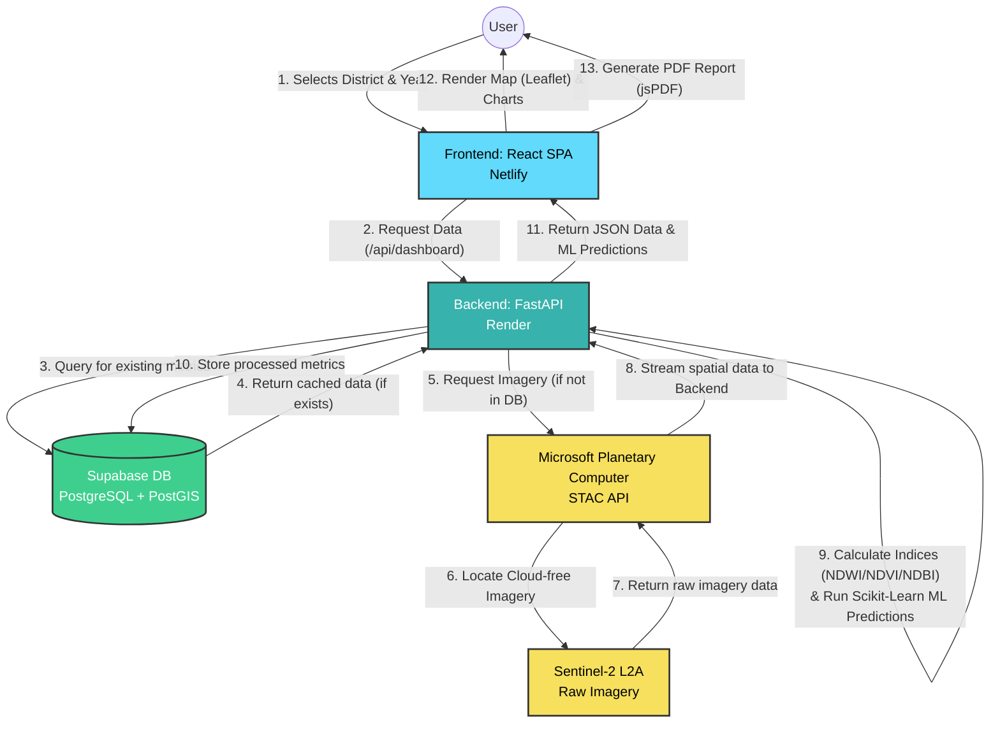

# 🛰️ OrbitWatch: Data Flow Architecture

This document visualizes the complete end-to-end data flow of the OrbitWatch platform, from the user's initial interaction to the fetching and processing of satellite imagery.

## Flowchart

## Step-by-Step Breakdown

1.  **User Interaction**: The user selects a specific district and year on the frontend dashboard.
2.  **API Request**: The React application sends an HTTP GET request to the FastAPI backend.
3.  **Database Check**: The backend first queries the **Supabase** database to see if the environmental metrics for that district and year have already been calculated.
4.  **Cache Hit (Fast Path)**: If the data exists in Supabase, it is returned immediately, skipping the expensive satellite download process.
5.  **External Query (Slow Path)**: If the data is missing, the backend makes an async HTTP request to the **Microsoft Planetary Computer STAC API**.
6.  **Data Acquisition**: The STAC API locates the relevant **Sentinel-2** satellite imagery that matches the geographical bounds of the district and is cloud-free.
7.  **Data Processing**: The backend downloads the raw satellite bands and uses Python libraries (Rasterio, Xarray) to calculate spectral indices (NDWI for water, NDVI for vegetation). It then runs historical data through Scikit-Learn to predict future trends.
8.  **Data Storage**: The newly processed metrics are saved into the Supabase database so future requests are instantaneous.
9.  **Response**: The backend sends a structured JSON payload back to the frontend containing all metrics, risk scores, and trend predictions.
10. **Rendering & Export**: The React frontend uses this JSON to dynamically paint the Leaflet maps, animate the Chart.js graphs, and populate the downloadable jsPDF report.
